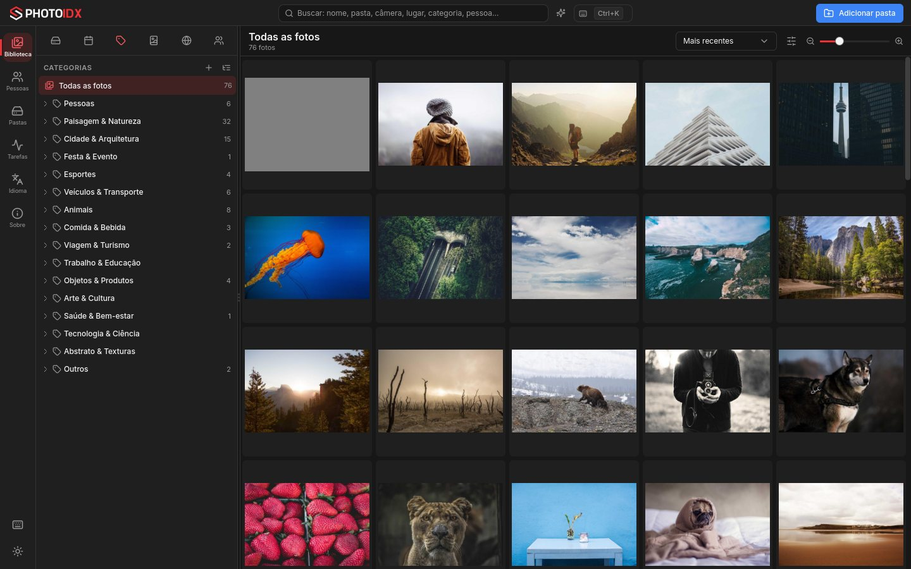
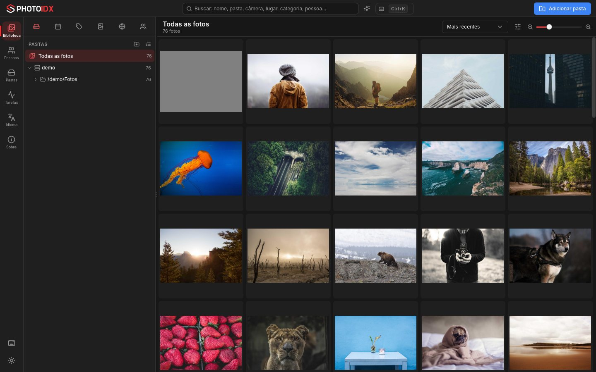
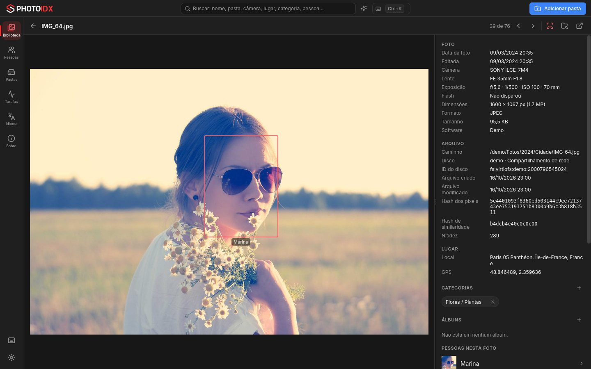
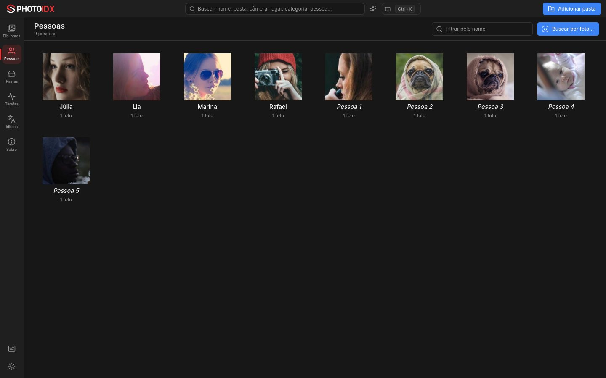
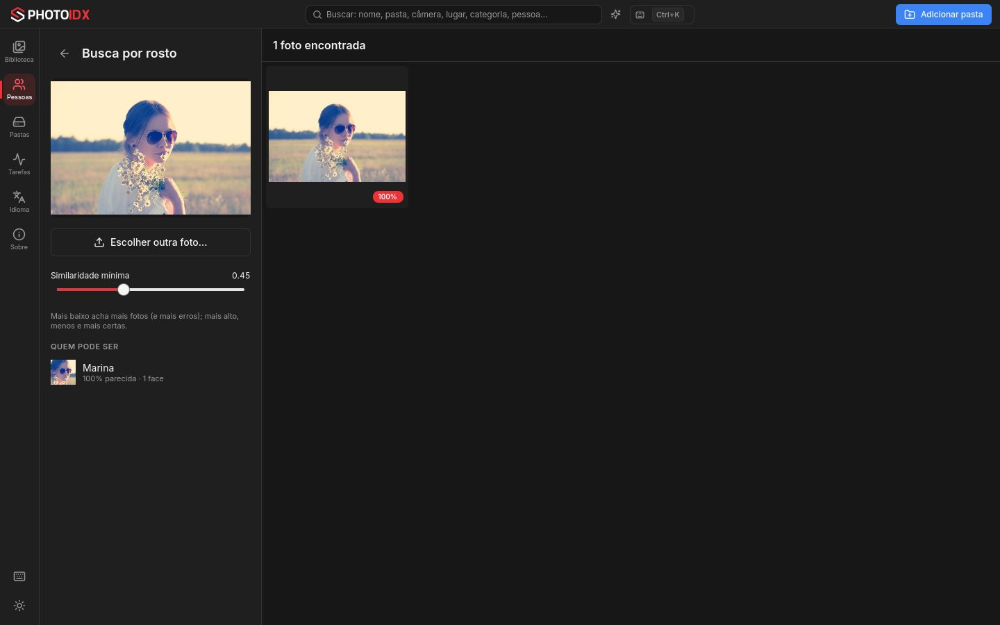
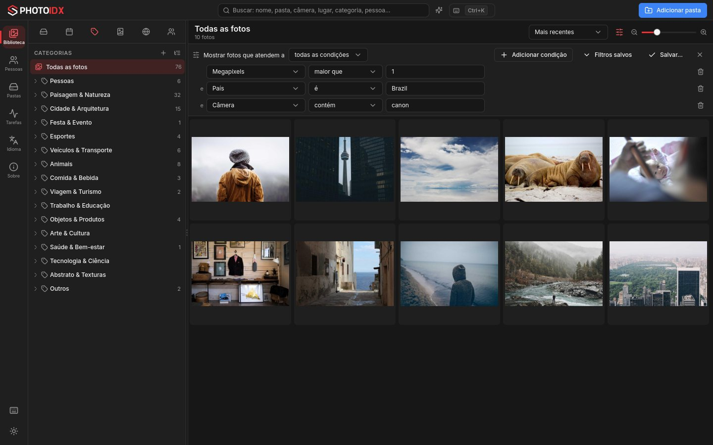
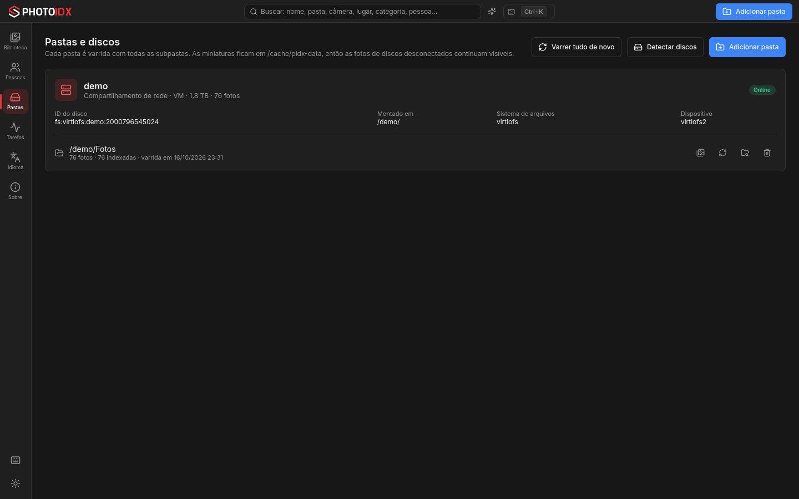
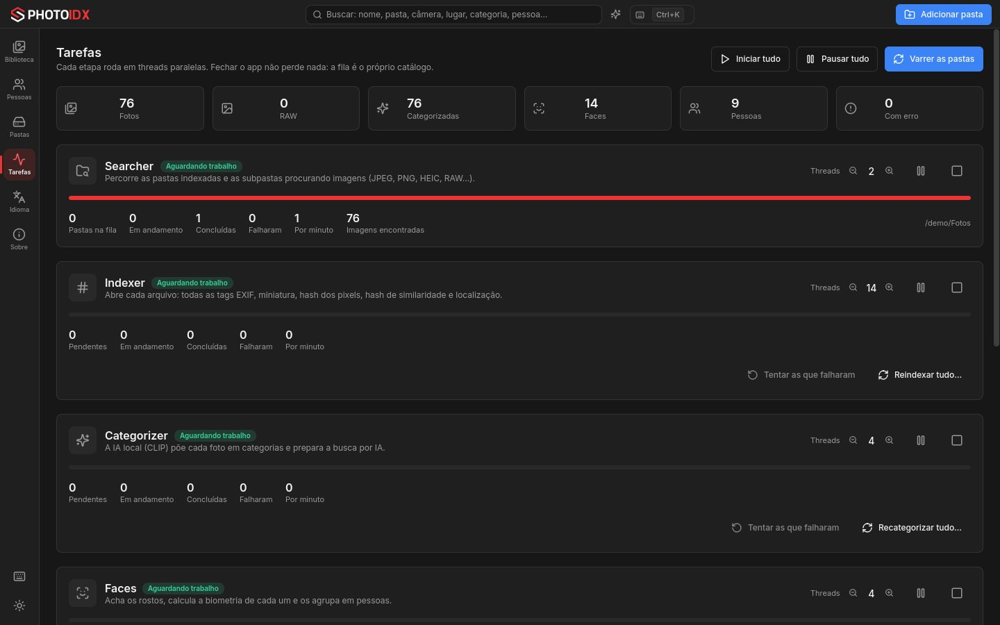

# PhotoIDX

**PhotoIDX é um catálogo de fotos livre ([BSD 2-Clause](./LICENSE)) que
organiza sozinho todas as suas fotos** — as do computador, as de HDs externos
e as de compartilhamentos de rede — por pasta, data, categoria, álbum, lugar e
pessoa. A inteligência artificial roda no seu computador: ela classifica as
fotos (praia, casamento, futebol, cachorro, comida…), reconhece as pessoas e
permite buscar descrevendo a foto ou mostrando o rosto de alguém.

Funciona como um **aplicativo normal** no Windows, no macOS e no Linux, sem
internet, sem conta e sem nuvem. **Suas fotos nunca são alteradas**: o app só
as lê — a única exceção é quando você pede para tornar uma foto
[privada](#fotos-privadas).



Site: <https://photoindexer.github.io/>

## Instalação

Baixe o instalador do seu sistema na página de
[**Releases**](https://github.com/PhotoIndexer/photo-indexer/releases):

| Sistema | Arquivo | Como instalar |
|---|---|---|
| macOS (Apple Silicon) | `PhotoIDX-<versão>-macos-arm64.dmg` | abra o `.dmg` e arraste o **PhotoIDX** para **Aplicativos** |
| macOS (Intel) | `PhotoIDX-<versão>-macos-x64.dmg` | idem |
| Windows 10/11 (Intel/AMD) | `PhotoIDX-<versão>-windows-x64.msi` | abra o `.msi`; o atalho aparece no Menu Iniciar e na Área de Trabalho |
| Windows 11 em ARM | `PhotoIDX-<versão>-windows-arm64.msi` | idem |
| Linux x64 / arm64 | `PhotoIDX-<versão>-linux-*.tar.gz` | descompacte e rode `bin/PhotoIDX` |

Requisitos mínimos: macOS 14, Windows 10/11 64 bits, ou Linux com glibc 2.39
(Ubuntu 24.04).

> **Primeira abertura:** os instaladores ainda não são assinados. No
> **macOS**, se aparecer "não foi possível verificar o desenvolvedor", vá em
> Ajustes do Sistema → Privacidade e Segurança → **Abrir Mesmo Assim**. No
> **Windows**, na tela do SmartScreen, clique em **Mais informações** →
> **Executar assim mesmo**.

## Primeiros passos

1. Clique em **Adicionar pasta** e escolha uma pasta — ou a raiz de um disco.
   O PhotoIDX percorre a pasta e **todas as subpastas**.
2. A indexação começa sozinha e roda em segundo plano; acompanhe pelo
   indicador no alto ou pela tela **Tarefas**.
3. Navegue pelo painel lateral e abra qualquer foto com um duplo clique.

### O painel lateral

Seis abas, cada uma com a sua árvore; a grade mostra as fotos do item
escolhido (inclusive o que está dentro dele):

| Aba | Organiza por |
|---|---|
| **Pastas** | as pastas indexadas e as subpastas, **separadas pelo disco de origem** |
| **Datas** | ano → mês → dia, pela data da foto (a do EXIF; sem EXIF, a do arquivo) |
| **Categorias** | as 16 categorias da IA e as subcategorias, mais as que você criar |
| **Álbuns** | os seus álbuns e sub-álbuns |
| **Lugares** | país → estado → cidade, pelo GPS da foto |
| **Pessoas** | cada pessoa reconhecida, com o nome que você der |

O tamanho das miniaturas muda pelo controle no alto da grade, por
<kbd>Ctrl</kbd>+roda do mouse ou por <kbd>Ctrl</kbd>+<kbd>=</kbd> e
<kbd>Ctrl</kbd>+<kbd>-</kbd>.



## A foto

O duplo clique abre a foto com tudo o que o catálogo sabe dela: data, câmera,
lente e exposição; o arquivo, o disco e o ID do disco; o hash dos pixels; o
lugar e as coordenadas; as categorias (da IA ou suas), os álbuns, as pessoas
(com o retângulo de cada rosto) e **todas as tags EXIF**, com filtro. Abaixo,
as fotos **iguais** (mesmos pixels) ou **parecidas** (árvore de hashes).



## Categorias por IA

O Categorizer usa o **CLIP** (OpenAI) localmente: cada foto é comparada com
frases que descrevem cada categoria e recebe as mais prováveis. São 16
categorias (Pessoas, Paisagem & Natureza, Cidade & Arquitetura, Festa &
Evento, Esportes, Veículos, Animais, Comida & Bebida, Viagem, Trabalho &
Educação, Objetos, Arte & Cultura, Saúde, Tecnologia, Abstrato, Outros) e
mais de 130 subcategorias. Uma foto pode estar em várias.

- Crie, renomeie, aninhe e apague categorias (botão direito na aba
  **Categorias**). Em **Frases da IA…** você ensina, em inglês, o que a IA deve
  procurar.
- Tire uma categoria de uma foto e a IA não a coloca de volta; ponha uma e ela
  fica.
- **Borrada**, **Duplicata** e **Sem categoria** são automáticas (nitidez e
  hashes).

## Pessoas

O reconhecimento facial é o mesmo do [PhotoE](https://photoe.com.br/)
(insightface): cada rosto é agrupado com a pessoa mais parecida, e uma pessoa
nova nasce quando ele não se parece com ninguém. Na tela **Pessoas**:

- dê nome a uma pessoa (se o nome já existir, o app oferece juntar as duas);
- **Juntar com…** une duas pessoas;
- marque faces e use **Não é esta pessoa** (falso positivo — ela nunca volta
  para lá), **Esta é…** ou **Nova pessoa…** (falso negativo);
- **Menos parecidas primeiro** põe no topo as faces mais suspeitas.

Pessoas muito parecidas e confiáveis (faces suficientes, detecção segura) se
juntam sozinhas; os limiares ficam em **Tarefas → Ajustes da IA**.



### Busca pelo rosto

**Buscar por foto…** recebe uma foto de alguém (de qualquer lugar do disco),
encontra os rostos dela e mostra todas as fotos em que a pessoa aparece,
ordenadas pela semelhança, e quem do catálogo ela pode ser.



## Busca e filtros

- **Busca** (<kbd>Ctrl</kbd>+<kbd>F</kbd>): todas as palavras precisam casar
  com o nome, a pasta, a câmera, a lente, o ano, a categoria, o lugar, a
  pessoa ou o álbum — sem diferenciar acentos.
- **Busca por IA** (<kbd>Ctrl</kbd>+<kbd>I</kbd> ou o ✦ ao lado da busca):
  descreva a foto, em inglês ("sunset at the beach", "kids playing
  soccer"), e veja as mais parecidas.
- **Filtro** (<kbd>Ctrl</kbd>+<kbd>Shift</kbd>+<kbd>F</kbd>): condições sobre
  qualquer campo — tamanho do arquivo, largura, altura, megapixels,
  orientação, datas, câmera, lente, ISO, abertura, velocidade, flash, GPS,
  país, estado, cidade, disco, categoria, álbum, pessoa ou qualquer tag EXIF —
  encadeadas com **todas** (E) ou **qualquer** (OU). Salve os filtros que usa
  sempre.



## Discos, rede e o catálogo

Cada pasta adicionada fica ligada ao **disco de origem**, reconhecido em
qualquer sistema pela identidade dele: UUID do volume (Linux e macOS), GUID do
volume (Windows), ou protocolo, servidor e compartilhamento de rede (SMB,
NFS, AFP, WebDAV, SSHFS). A tela **Pastas** mostra cada disco e as pastas
dele.

- Disco desconectado: as fotos continuam na grade (as miniaturas ficam no seu
  computador) e a foto aberta mostra a miniatura, com um aviso.
- Disco que volta em outra letra ou ponto de montagem: o catálogo refaz os
  caminhos sozinho.
- Arquivo apagado do disco: sai da grade no próximo escaneamento.



## Fotos privadas

Selecione fotos e escolha **Tornar privada**: elas somem de toda a biblioteca
(pastas, datas, categorias, lugares, busca, pessoas, duplicadas) e só
aparecem no álbum **Privado**, com a senha.

- **O arquivo original é criptografado** (AES-256-GCM) em `nome.photoidxe`,
  na mesma pasta, e o original é apagado só depois de a cópia ser decifrada
  e conferida. O SHA-256 de antes e de depois fica guardado no catálogo.
- A miniatura também é criptografada; as faces saem de Pessoas.
- **Tornar pública** devolve o arquivo com o nome e os bytes originais.
- Abrir uma foto privada pede a senha; o app tranca sozinho depois de um
  tempo sem uso (ajustável) e sempre que é fechado.

**A chave.** Na instalação o PhotoIDX gera uma chave de criptografia
aleatória (256 bits), guardada no catálogo protegida pela sua senha
(PBKDF2-HMAC-SHA512, 600 mil iterações). Na primeira vez o app mostra a chave
para você **copiar e guardar fora do computador** — é com ela que você
recupera as fotos se esquecer a senha. A tela **Privadas** mostra, copia e
troca a chave (as fotos são criptografadas de novo, em segundo plano) e troca
a senha.

> Sem a chave e sem a senha, ninguém recupera as fotos privadas — nem o
> PhotoIDX. O catálogo continua sabendo nome, data, câmera, lugar e EXIF das
> fotos privadas (para a busca dentro do álbum Privado); o que fica
> criptografado é a imagem.

## Tarefas

A indexação roda em etapas, cada uma com o seu grupo de threads:

| Etapa | O que faz |
|---|---|
| **Searcher** | percorre as pastas e subpastas atrás de imagens (JPEG, PNG, HEIC, TIFF, WebP e RAW) |
| **Indexer** | lê o arquivo: todas as tags EXIF, a data, a miniatura, o hash dos pixels, o hash de similaridade e o lugar (GPS) |
| **Categorizer** | a IA põe a foto em categorias e prepara a busca por IA |
| **Faces** | acha os rostos, calcula a biometria de cada um e agrupa em pessoas |
| **Privadas** | criptografa/descriptografa os arquivos das fotos privadas (só com o cofre aberto) |

A tela **Tarefas** mostra o andamento (pendentes, em andamento, concluídas,
falhas, itens por minuto) e permite pausar, retomar, cancelar, mudar o número
de threads, refazer uma etapa e ajustar a IA. Fechar o app no meio não perde
nada.

Para não tomar conta do computador há um **teto de tarefas simultâneas**
somando todas as etapas (padrão: metade dos núcleos, entre 2 e 8) e um limite
de memória para abrir imagens grandes (25% da RAM).



## Onde ficam seus arquivos

Suas fotos ficam onde estão. O que o PhotoIDX gera fica em `~/.photo_indexer`
(no Windows, `C:\Users\<você>\.photo_indexer`):

```
~/.photo_indexer/
    data.sqlite3                    o catálogo
    thumbnail/YYYY/MM/<uuid>.jpg    as miniaturas (uuid = id da foto;
                                    .pidx = criptografada, foto privada)
    faces/YYYY/MM/<uuid>.jpg        os recortes dos rostos
    logs/                           o log do app
```

Essa pasta nunca é indexada, mesmo que você adicione a raiz do disco.

## Atalhos

| Atalho | Ação |
|---|---|
| <kbd>Ctrl</kbd>+<kbd>1</kbd> … <kbd>4</kbd> | Biblioteca, Pessoas, Pastas, Tarefas |
| <kbd>Ctrl</kbd>+<kbd>O</kbd> | adicionar pasta |
| <kbd>F5</kbd> | escanear todas as pastas de novo |
| <kbd>Ctrl</kbd>+<kbd>F</kbd> / <kbd>Ctrl</kbd>+<kbd>I</kbd> | buscar / ligar a busca por IA |
| <kbd>Ctrl</kbd>+<kbd>Shift</kbd>+<kbd>F</kbd> | mostrar ou esconder o filtro |
| <kbd>Ctrl</kbd>+<kbd>A</kbd> / <kbd>Esc</kbd> | selecionar tudo / limpar a seleção |
| <kbd>←</kbd> <kbd>→</kbd> | foto anterior / próxima (na foto aberta) |
| <kbd>F</kbd> | mostrar ou esconder os rostos (na foto aberta) |
| <kbd>Ctrl</kbd>+<kbd>K</kbd> | paleta de comandos |
| <kbd>Ctrl</kbd>+<kbd>/</kbd> | ver e trocar os atalhos |

No macOS, <kbd>Ctrl</kbd> é <kbd>⌘</kbd>.

## Para desenvolvedores

App nativo em **C++20 + Qt 6 (QML)**, com OpenCV, LibRaw e ONNX Runtime; a
arquitetura está em [`docs/ARCHITECTURE.md`](./docs/ARCHITECTURE.md) e as
convenções em [`CLAUDE.md`](./CLAUDE.md). Tudo compila e empacota em Docker:

```sh
make help      # lista os alvos
make model     # baixa os modelos de IA (CLIP e insightface) em .cache/models
make test      # compila e roda os testes no builder Linux
make local     # instalador do sistema e da arquitetura desta máquina
make site      # monta o hotsite (docs/site) em .cache/site
```

## Licença

[BSD 2-Clause](./LICENSE). Componentes de terceiros: Qt (LGPL), OpenCV
(Apache-2.0), ONNX Runtime (MIT), LibRaw (LGPL-2.1/CDDL), OpenAI CLIP (MIT),
GeoNames (CC BY 4.0). **Os modelos de reconhecimento facial do insightface
(buffalo_sc) são licenciados apenas para pesquisa não comercial.**
